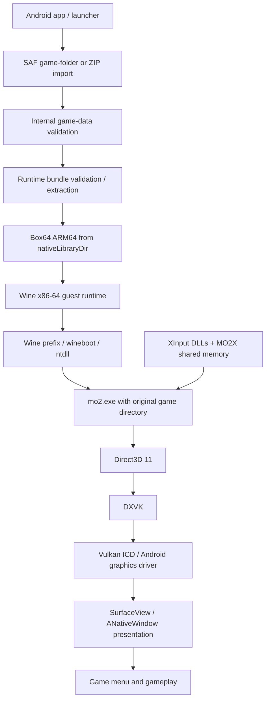

# Moving Out 2 Android

[](https://github.com/dnctf/Moving-Out-2-Android)
[](https://developer.android.com/ndk/guides/abis)
[](https://github.com/dnctf/Moving-Out-2-Android)
[](https://github.com/dnctf/Moving-Out-2-Android)

An experimental Android ARM64 compatibility launcher/runtime wrapper for running the Windows x86-64 edition of **Moving Out 2**. The project integrates Box64, Wine, DXVK, Vulkan driver selection, game-data import, and an XInput bridge.

> **Development status:** Active development. CI has built and verified a Debug APK, but physical execution of Box64/Wine, Wine prefix bootstrap, DXVK presentation, and successful entry into the game have not yet been demonstrated on the reference device. A successful JVM/NDK build is not proof of playable gameplay.

This is an independent community project and is not affiliated with Team17 or SMG Studio.

## Project targets

| Item | Target |
|---|---|
| Game | Moving Out 2, Windows x86-64 |
| Game build | v1.2.274 (user-supplied installation) |
| Engine | Unity 2021.3.16f1 / IL2CPP |
| Graphics API | Direct3D 11 via DXVK → Vulkan |
| Android ABI | `arm64-v8a` |
| Android API | Android 8.0+ (minSdk 26); target SDK 35 |
| Reference device | Huawei MatePad Air DBY2-W09 |
| Reference SoC/GPU | Snapdragon 888 / Adreno 660 |
| Reference memory | 8 GB RAM |
| Performance objective | 30 FPS target, initially 70–75% render scale; not yet validated |

## Runtime execution pipeline



The diagram describes the intended execution path. Individual stages remain subject to the verification matrix below; in particular, the Vulkan probe is not equivalent to a Wine/DXVK swapchain connected to the Android `SurfaceView`.

## Runtime components

| Component | Implementation / current evidence | Status |
|---|---|---|
| Android app | Kotlin, Android SDK 35, arm64-v8a | CI build verified |
| SAF importer | Transactional copy into app-private storage, structural validation | Implemented; unknown-size provider handling patched and awaiting CI confirmation |
| Runtime bundle | Manifest/schema and SHA-256 validation, ZIP extraction | Automated validation exists; device install/launch not proven |
| Box64 | ARM64 native executable packaged as `lib/arm64-v8a/libbox64.so`; legacy JNI packaging | Debug APK packaging and ELF inspection verified; on-device exec still required |
| Wine | x86-64 Wine binaries and guest glibc search paths | Bootstrap code and unit tests present; `wineboot`/ntdll device execution unverified |
| DXVK | D3D11/DXGI native overrides | DLL/configuration presence is not proof of rendering |
| Vulkan | Native Vulkan capability/swapchain probe | Probe builds; Wine/DXVK WSI integration and device presentation unverified |
| Turnip | Optional Mesa Freedreno ICD payload | Device driver load and stability unverified |
| XInput | xinput1_3, xinput1_4, xinput9_1_0 and MO2X bridge | DLL build/package and protocol CI checks pass; in-game input unverified |
| Game launch | `mo2.exe`, original game working directory | Not yet verified on physical hardware |
| Main menu/gameplay | End-to-end game session | Not yet verified |
| 30 FPS target | Snapdragon 888 / Adreno 660 | Performance target only; no benchmark claim |

## Build and CI

The Android CI workflow runs the JVM unit-test task, builds a Debug APK, verifies the merged manifest (native extraction, large heap and target SDK), inspects extracted ARM64 ELF payloads and 16 KB LOAD alignment, and uploads a short-lived Actions artifact. The CI pipeline does **not** establish that the game runs on an Android device.

Typical local commands:

```bash
./gradlew testDebugUnitTest --stacktrace
./gradlew assembleDebug
```

The CI workflow uses Gradle 8.9, JDK 17, Android SDK 35, and NDK 27.2.12479018.

Debug APK artifacts are temporary CI outputs, not public releases. Public GitHub Releases are intentionally withheld while runtime and physical-device gates remain open.

## Setup and usage

1. Build or obtain a Debug APK from a successful CI run. Do not treat an artifact as a stable release.
2. Obtain the runtime bundle from a trusted project build artifact or the project's documented runtime-bundle source. Verify its SHA-256 before importing it.
3. Open the app and import the runtime ZIP when prompted. Wait for extraction and manifest/hash validation to finish.
4. Select the root directory of the user's own Moving Out 2 Windows installation through Android's Storage Access Framework (SAF), or use the supported game ZIP import flow.
5. Ensure the selected root contains a Unity player executable such as `mo2.exe`, its matching `<executable>_Data/` directory (for example `mo2_Data/`), `UnityPlayer.dll`, `GameAssembly.dll`, and `baselib.dll`. The validator pairs the executable with its matching data directory rather than requiring a fixed `MovingOut2.exe` name. Preserve `mo2_Data/Plugins/x86_64/` and original binary/resource files (`*.assets`, `*.resS`, `il2cpp_data/`, `StreamingAssets/`) byte-for-byte. The original RUNE files, when present in the user's installation, must remain together in the game directory.
6. Connect a compatible Bluetooth or USB controller if testing physical input. XInput translation is experimental until validated inside the game.
7. Do not assume the Play action will reach the game: inspect the session diagnostics if bootstrap or launch fails.

### Diagnostics

When reporting a failure, export the app's **Diagnostic ZIP** and include it with:

- Android model, Android version, ABI, SoC/GPU and driver information;
- runtime manifest and SHA-256 validation report;
- Box64 execution probe result, including stdout, stderr and exit code;
- Wine bootstrap/session logs, including `wineboot --init` exit status;
- Wine prefix registry validation status;
- DXVK/Vulkan/SurfaceView probe output;
- game executable validation and process exit status;
- XInput bridge/controller diagnostics.

Remove personal file paths or other private information before sharing diagnostics publicly.

### Device smoke test (Snapdragon 855+ / 888, Adreno 640+ / 660)

Use an ARM64 Android device with the system Vulkan driver first. Install the APK and capture logs:

```bash
adb install -r app-debug.apk
adb logcat -c
adb logcat -v threadtime > mo2-device.log
```

After importing the runtime bundle and the user's game directory, launch once and export the in-app Diagnostic ZIP. Check that the report records a successful Box64 exec probe, Wine prefix bootstrap (`system.reg` and `user.reg`), `x86_64-unix/ntdll.so` and `win32u.so`, DXVK D3D11 device creation, Vulkan Surface presentation, and MO2X XInput packets. A process state of RUNNING alone does not establish that the main menu rendered. Long-press the Runtime status panel for the live process/player log tail. Filter a saved log with:

```bash
grep -Ei 'box64|wine|ntdll|win32u|steam_api64|Team17|Unity|IL2CPP|DXVK|Vulkan|Surface|XInput|MO2X|SIGSEGV|SIGABRT|EACCES' mo2-device.log
```

The on-screen controller is attached while a session is active and sends touch state through XInput player slot 0. Physical controller devices use the existing per-device routing. Neither touch input nor physical input should be considered game-verified until movement and actions are observed in the game.

## Game data and legal notice

This repository is a compatibility launcher/runtime wrapper. **It does not include, host, or distribute Moving Out 2 game files, copyrighted assets, proprietary DLLs, Steam emulation files, or a preinstalled game image.** Users are responsible for supplying game data they are legally entitled to use. Do not upload game archives, RUNE/Steam wrapper files, or other copyrighted game content to this repository or its issue tracker.

## Contribution and issue reports

Please include the exact commit or CI run, device details, reproduction steps, and a redacted Diagnostic ZIP when filing runtime issues. Clearly distinguish automated test results from behavior observed on physical hardware.
